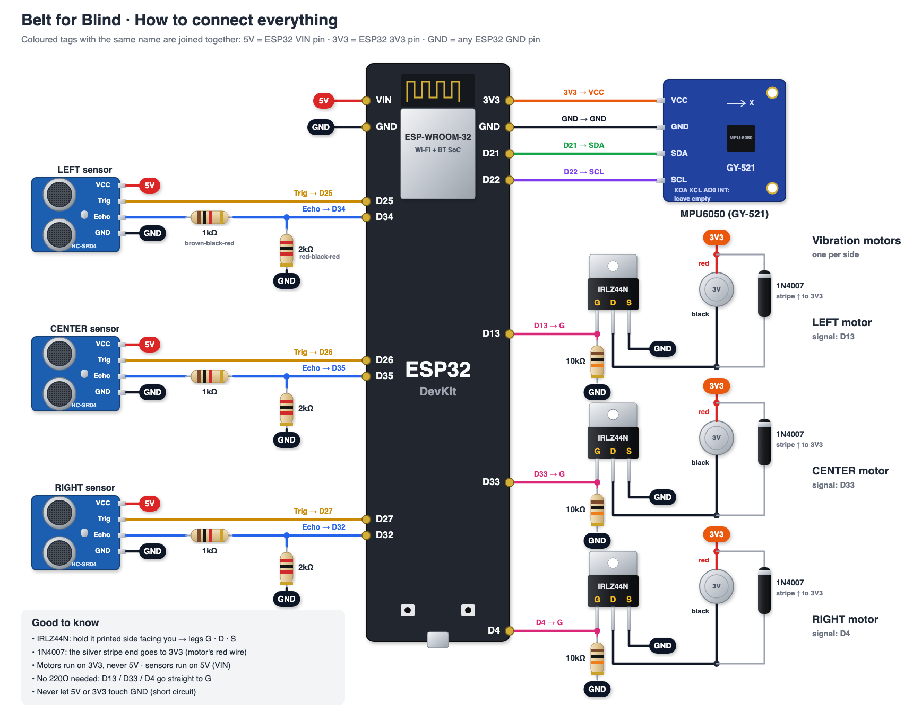

# Belt for Blind

ESP32 + 3 × HC-SR04 ultrasonic sensors, a vibration motor for alerts and an MPU6050 IMU. The belt measures distances and vibrates when something is too close. It pauses while the wearer sits, to save battery, and wakes when they stand up or walk.

## Wiring



There is also a [schematic version](docs/wiring-diagram.png).

Pin names below are as printed on the ESP32 DevKit board (`D25` = GPIO 25). `VIN` gives 5V when the board is powered over USB.

| Sensor | VCC | GND | TRIG | ECHO |
|--------|-----|-----|------|------|
| Left   | VIN | GND | D25  | D34  |
| Center | VIN | GND | D26  | D35  |
| Right  | VIN | GND | D27  | D32  |

IMU (MPU6050 / GY-521 module): `VCC` → `3V3`, `GND` → `GND`, `SDA` → `D21`, `SCL` → `D22`. Fix it firmly to the belt, because sitting is detected from its tilt.

Three 3V coin vibration motors, one per side, each switched by a logic-level N-channel MOSFET:

| Motor | Signal pin |
|-------|-----------|
| Left   | `D13` |
| Center | `D33` |
| Right  | `D4`  |

For each motor:

| From | To |
|------|----|
| Signal pin | 220Ω resistor → MOSFET gate |
| MOSFET gate | 10kΩ resistor → `GND` (keeps the motor off while the ESP32 starts) |
| MOSFET source | `GND` |
| MOSFET drain | motor − (black) |
| Motor + (red) | `3V3` |
| 1N4007 diode across the motor | striped end on motor + / `3V3` |

The MOSFET must turn fully on at 3.3V (e.g. IRLZ44N, AO3400); IRFZ44N or IRF540N won't.

Each motor runs when its sensor sees something too close: Left or Right under 15 cm, Center under 30 cm (set per sensor by `alertCm` in `src/main.cpp`).

**Important:** the HC-SR04 ECHO pin outputs 5V, but ESP32 pins are 3.3V. Put a voltage divider on each ECHO line
(ECHO → 1kΩ → GPIO, and GPIO → 2kΩ → GND), or use HC-SR04P / RCWL-1601 sensors that run at 3.3V.

## Run

1. Open this folder in VS Code (PlatformIO extension installed).
2. Plug in the ESP32 over USB.
3. Click **Upload** (→ arrow in the bottom status bar), then **Serial Monitor** (plug icon).

Expected output:

```
---------------- distance to obstacle ----------------
  Left      42 cm   ####                  VERY CLOSE
  Center     --      nothing in front
  Right   NO SIGNAL - check this sensor's wires
  Motor   off
  IMU     tilt   3 deg   motion 0.012 g
```

Move your hand in front of each sensor. If its number changes, that sensor works.

- `nothing in front`: the sensor works, but nothing within ~5 m reflected the sound back.
- `NO SIGNAL`: the sensor isn't answering at all. Check its Trig, Echo, VCC and GND wires.

The belt pauses after the wearer has been still for 5 s and tilted more than 20° from upright. It wakes when they return within 12° of upright or walk for 1 s. If the IMU isn't found, the belt stays on. Tune these limits from the `IMU` line, using the constants at the top of `src/main.cpp`.

## Live view in the browser

A web page that draws the ESP32, the three sensors, the three vibration motors and the MPU6050, and shows each detection, which motors are vibrating, the IMU's tilt and motion, and when the belt is paused because the wearer sits.

1. Close the Serial Monitor: only one program can use the USB port at a time.
2. Run, from this folder:
   ```
   ~/.platformio/penv/bin/python tools/live-view/server.py
   ```
3. Open http://localhost:8000: the live 3D workspace with the clickable **Wiring** section below it.
   The 2D sensor dashboard is at http://localhost:8000/dashboard.

Stop it with Ctrl+C before uploading new firmware.

### Live 3D workspace

With the server running, **http://localhost:8000** opens the 3D workspace
(`/3d` still works). The 2D dashboard is at `/dashboard`. Both pages (and Blender)
can be open together; only the server opens the USB port.

Below the 3D view, the **Wiring** section shows the realistic wiring picture. Click any part,
pin, wire or 5V / 3V3 / GND tag: it lights up with everything it connects to, and the panel
beside it lists each connection. Regenerate the picture with `python3 tools/wiring/make_wiring_image.py`.

The separate 3D page displays the actual exported Blender prototype, with its
component geometry, wiring and printed labels, lit by the same Artist Workshop
HDRI. Drag to orbit, scroll/pinch to zoom, and right-drag to pan. Use **Reset view**
to return to the Blender camera, or **Full screen** for an immersive view.

Keep the real board flat and still when opening the page. The first valid gravity
reading becomes level, just as when running Blender's `live_link.py`. Moving the
board then tilts the entire model with the same axis mapping and smoothing.
**Set this position as level** recalibrates without changing your camera view.
If forward tilt appears sideways, adjust **Sensor mounting** (0°, 90°, 180°, 270°).
Like the Blender link, gravity-based orientation shows tilt, not rotation around
the vertical axis. The current firmware must output `gravity x y z` in its IMU line.

Sensor beams extend to the measured distances (capped visually at 2 m), motors
glow and emit rings while active, and sitting pauses those effects. Old readings
are cleared after 3 seconds without fresh data; the last orientation stays still.

The Three.js renderer is included locally, so internet access and an open Blender
window are not needed. If the optional HDRI is missing, the viewer uses studio
lighting; install it with the download command in the Blender section below and
reload. Browser lighting/materials approximate Blender's rendering: procedural
microtextures and EEVEE reflections are not identical.

After editing the Blender model, update the web asset with:
```
/Applications/Blender.app/Contents/MacOS/Blender -b 3d-model/belt_for_blind.blend -P 3d-model/export_web.py
```
This exports `tools/live-view/assets/belt_for_blind.glb` and `scene.json` without
overwriting the `.blend`. It also copies `TURN_SENSOR_DEG` from `live_link.py`.
To check the browser's orientation and live-state logic, run:
```
node --test tools/live-view/tests/*.test.mjs
```

## 3D model (Blender)

`3d-model/belt_for_blind.blend` is a to-scale model of the breadboard prototype. Rebuild it with:
```
/Applications/Blender.app/Contents/MacOS/Blender -b --factory-startup -P 3d-model/build_model.py -- 3d-model/belt_for_blind.blend
```

The realistic background is the CC0 [Artist Workshop](https://polyhaven.com/a/artist_workshop) HDRI from Poly Haven. It is not in git (25 MB), so download it once, or the background shows pink:
```
mkdir -p 3d-model/hdri && curl -L -o 3d-model/hdri/artist_workshop_4k.hdr https://dl.polyhaven.org/file/ph-assets/HDRIs/hdr/4k/artist_workshop_4k.hdr
```

To make it follow the real sensors: start the live-view server (above), open the file, go to the **Scripting** tab and click **Run Script** on `live_link.py`. Click it again to stop.
